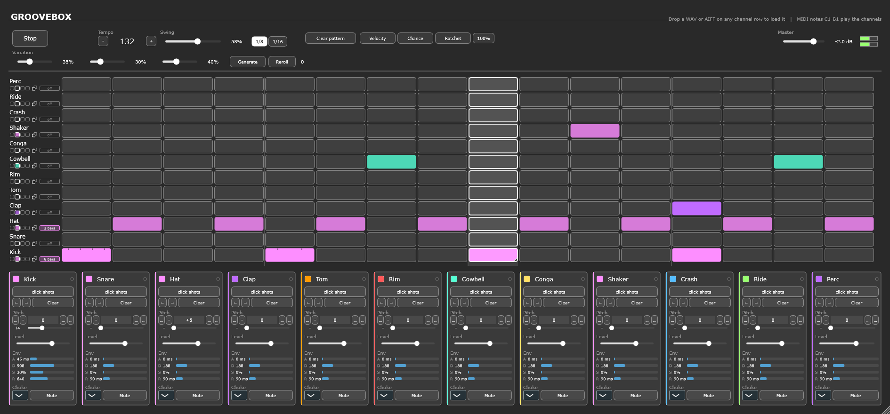
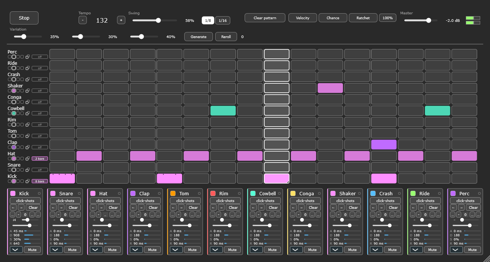
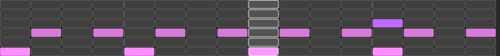
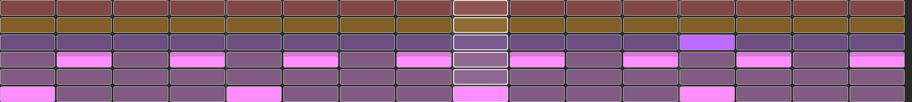
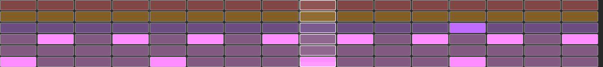
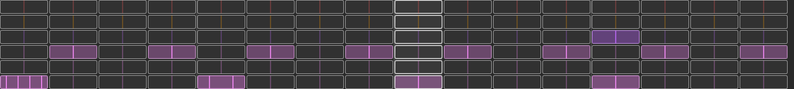
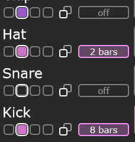
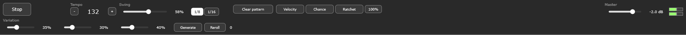
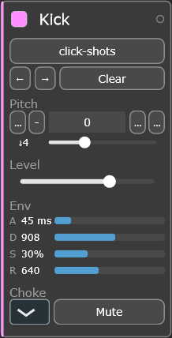
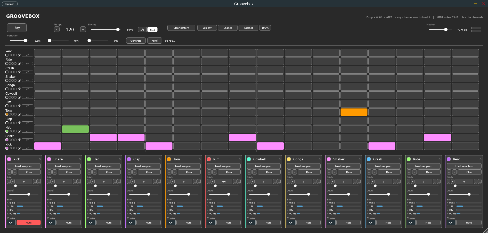

# Groovebox



A VST3 / standalone drum machine built from the drum page of **Earworm Studio**
(`earworm-studio/index.html`): a 16-step sequencer where each drum channel is a
sample you drag onto its row, and which also plays from MIDI notes.

**Version 0.2.1** — Windows x64, JUCE 8.0.4 / C++17, shipped as a VST3 instrument and a
standalone executable with its own transport. Licensed **AGPL-3.0-or-later** (see
[Licence](#licence)); the build is not code-signed and no samples ship with it. There is no
published binary yet: the repo is the source, and `cmake --build` plus
`installer\build-installer.ps1` produce the standalone and the setup file in `launch\`,
which is what the [Building](#building) and
[Installing](#installing) sections walk through. Everything on this page describes the build
that is actually installed on the author's machine, and every picture is that build's own
output.

## At a glance

| | |
|---|---|
| Grid | 16 steps × 12 drum lanes, four pattern takes per lane, and a lane can rotate through the ones it holds every 1, 2, 4 or 8 bars |
| Sound | Drag a sample onto any lane row, or use that lane's sound button to browse: `.wav`, `.wave`, `.aif`, `.aiff`, `.aifc`, `.mp3`, `.ogg`, `.oga`, `.opus`, `.m4a`, `.aac` and `.flac` all load |
| Per hit | Its own velocity, its own probability of firing, and a strike count of 1 to 8 with three choke groups per lane |
| Per lane | Pitch −36 to +12 semitones, a pitch drop of 0 to 12 semitones that glides down onto the note over 30 ms, a full attack-decay-sustain-release envelope, level and mute |
| Groove | Swing 0 to 100 % on a 1/8 or a 1/16 grid, *Humanize* (late only, never past a quarter of a step), *Touch* (never more than a quarter of a step's own level), a seed, and a generator over a 29-genre table |
| Output | Per-lane faders, a −24 to +6 dB master trim, a peak bar with a tick for the true peak between the samples, and a clip latch — and deliberately no limiter |
| Host | 116 automatable parameters (8 global plus 9 for each lane); MIDI notes C1 to B1 play the twelve lanes with velocity; the panel follows what the host drew |
| Proof | 628 timing and DSP checks, 698 layout checks and 86 pattern-planner checks, all run headless and tracked by CTest |

## Screenshots

These are not mockups. `GrooveboxLayoutTest.exe --shots docs\images` renders the real editor
headless and writes these files, so a picture cannot drift away from a build, and the last
image is the same window captured off the desktop rather than drawn by the test — it matches
the renders control for control, which is what makes the renders worth publishing.

One thing to know before you read the strips: the rendered shots load every lane with the
harness's own synthetic click fixture, so a sound button reads `click-shots` where your
session would read `Load sample...`, and the levels and envelope numbers shown are the ones
the harness armed to make each control legible in a picture. The live capture is the app
with nothing loaded, which is why it looks bare.

### The panel, and the smallest window it takes




The floor is derived, not typed: 1298 px comes from the transport bar's own wrap point and
695 px from what the twelve strips and the grid band need at that width, so the two limits
cannot disagree with each other. It is a *window* floor. A 1366 × 768 laptop leaves roughly
730 px of usable height, so 695 fits a window on that screen; that sentence says nothing
about the plugin maximised inside a DAW's own chrome, which has less room than the screen
does. See [Layout](#layout).

### The grid, and the three overlays









Each overlay is a mode of the same grid, not a second panel: the bar in the top row picks
which field a drag writes, and only one of the three can be lit at a time. The three
features are documented under [Step velocity](#step-velocity), [Step probability, and the
take](#step-probability-and-the-take) and [How many times a hit
fires](#how-many-times-a-hit-fires).

### The pattern bank in a lane's label column



Four takes per lane, which one the lane is pointed at, and whether it walks them on a
period — [Four patterns per channel](#four-patterns-per-channel).

### The transport bar, and one channel strip






The strip is rendered at one and a half times its on-screen size so the captions are
readable in a picture. The envelope numbers in it are the ones the harness armed, and the
drop reads `↓4` — four semitones above the note, gliding down onto it.
[The envelope](#the-envelope) and [Mix, headroom and the
meter](#mix-headroom-and-the-meter) cover both controls.

### The same window, captured live



Captured off the desktop rather than drawn by the test, at the window the standalone opens
with. Every control sits where the render above says it sits, which is the evidence that the
renders on this page are the product and not a picture of the test harness.

## What it does

| Feature | Detail |
|---|---|
| Step grid | 16 steps per bar, 12 drum channels, painted in the channel's own colour |
| **MIDI input** | **Play the channels from a keyboard or pads: the channels answer C1 upwards, with velocity** |
| **Step velocity** | **Every step has its own velocity. Hit *Velocity* in the top bar and drag up or down inside a step to set how hard it hits** |
| Sample loading | Drag an audio file onto any channel **row**, or click the channel's sound button to browse. Twelve extensions load: `.wav` `.wave` `.aif` `.aiff` `.aifc` `.mp3` `.ogg` `.oga` `.opus` `.m4a` `.aac` `.flac` |
| Per-channel pitch | −36 to +12 semitones, with `-12` / `+12` octave buttons |
| **Pitch drop** | **0–12 semitones per channel: the hit starts that far above the note and glides down onto it over 30 ms — kick bloom you cannot get from Live's sample page. It is a parameter like the rest, never something the plugin decides for you** |
| **ADSR per channel** | **Attack, Decay, Sustain and Release for every channel, so a hit can be tightened or turned into a sustained sound** |
| **Choke groups** | **Three per lane. A hit in a group cuts every other hit in that group short, ramped over 20 ms — put the closed hat in the same group as the open one and it stops it instead of stacking on it** |
| **Step probability** | **Every step says how often it is allowed to fire, 0–100 %. Hit *Chance* in the top bar and drag inside a step; a step that can be dropped has its corner cut off. The *Variation* knob — parameter **Mutate** — decides how much of that the machine may use: shut, the grid is law** |
| Swing | 0–100 % on either a 1/8 or 1/16 grid |
| **Humanize** | **0–100 %: a hit is allowed to start a little behind its step. Late only, never past a quarter of a step, and it follows the tempo rather than a fixed delay — the *Humanize* fader in the top bar, double-click to shut** |
| **Touch** | **0–100 %: a hit is allowed to be struck a little off the velocity its step says. Both ways, never past a quarter of that step's own level, and a rest stays a rest — the *Touch* fader in the top bar, double-click to shut** |
| **Rolls** | **Every step can fire 1–8 times instead of once. Hit *Ratchet* in the top bar and drag inside a step: each strike gets an equal share of the room to the next onset, so the roll follows the tempo and the swing grid the way swing does, and eight of them cannot reach into the step after** |
| Tempo | Follows the host project tempo; in the standalone build it has its own transport and tempo |
| Mix | Per-channel level and mute, plus a "clear row" button |
| **Master trim & meter** | **A −24 to +6 dB master trim you can see and reach, a bar for the sample peak with a tick for the true peak hiding between the samples, and a clip latch on the output** |
| **Automation** | **Levels, pitches, pitch drops, envelopes, mutes, choke groups, swing, swing grid, tempo, the master trim, Mutate, Humanize, Touch and Seed are host parameters — automate them, and the panel follows what the host drew** |
| **Pattern bank** | **Four patterns per channel. The row of marks in a channel's label column points the lane at one of them, the copy mark duplicates the row into the next empty slot, and the chip on the right lets the lane rotate through what it holds every 1, 2, 4 or 8 bars** |
| Row editing | Click a cell to toggle it; drag across cells to paint a run |
| **Shift a row** | **The ← and → buttons in a channel strip turn that whole row one step earlier or later, and each step's level, chance and strike count go with it** |
| Persistence | Every slot's steps, velocities, probabilities and strike counts, which slot each lane points at, each lane's rotate period, pitch, levels, mutes, names, colours, seed and sample paths are saved in the session; a session saved before the parameter migration is read in and its values carried over |

## Step velocity

Every step carries its own velocity, so a pattern can have accents instead of
every hit landing at the same level.

Press **Velocity** in the top bar to switch the grid into velocity editing. A bar
rises from the bottom of each step showing how hard it hits, with the value under
the pointer; drag up or down inside a step to set it. The value is taken from how
high the pointer is in the row, so the bar follows the pointer.

- **The step's on/off state is left alone.** You can set a level on a step that is
  switched off, and dragging to nothing never switches a step off. An on step is
  never stored as "off", so a quiet hit stays a hit.
- **Press 100%** to put every step back to full velocity. It is the same button the
  probability and strike-count overlays use, and it does whichever of the three is on
  the grid — the button reads **x1** rather than **100%** over a strike count, and a
  click then puts every step back to one strike. The tooltip says which before you
  click, and one undo takes the whole grid back.
- **Shifting a row moves what each step says too.** The ← and → buttons in a channel
  strip turn that row one step earlier or later, and each step carries its velocity
  with it, so an accented pattern stays accented after it moves — its probability and
  its strike count go the same way, and the other three pattern slots of that lane are
  left where they were written. The last step wraps round to the first rather than
  falling off the end.
- Outside velocity mode the steps are dimmed by their velocity, so you can see the
  dynamics without opening the overlay.
- The grid's velocity and a played note's velocity are separate: the grid uses the
  value on the step, while a pad or keyboard uses how hard you hit it.

**Velocity is two laws, not one.** It scales the level, and it also opens the top
end: a hit is played through a lowpass whose corner rises with how hard it was
struck, from 900 Hz at the very bottom of the travel to **no filter at all at full
velocity**. That last part is the point — the loudest thing the machine plays is the
recording exactly as it is, bit for bit, so the law can only ever change the hits you
asked it to.

| Velocity | Corner | What it means |
|---|---|---|
| 100 % | none | the sample as recorded |
| 50 % | about 5.8 kHz | played, not turned down |
| 25 % | about 2.9 kHz | soft: the sizzle is off the top |
| 6 % | about 1.4 kHz | a muted strike |

A dimmed hit also loses whatever level lived above its corner, so a soft hit comes
out a little *under* what the gain alone would give — measured on a flat noise burst
at 1.9 dB of peak at 25 % velocity and 4.0 dB at 6 %, which is the worst case, since
a sample with a body keeps most of its energy below those corners. The fader, by
contrast, moves level only: the same quarter of a gain by the fader leaves the tone
exactly where it was, and both of those are checked by name in the test suite.

## Step probability, and the take

Every step also says how *often* it is allowed to fire. That is the other half of a
pattern: not how hard the hit is, but whether it is there this time round.

Press **Chance** in the top bar to put that number on the grid. The same drag sets it,
and the bar hangs from the top of the cell instead of rising from the bottom: the gap
underneath is the part that gets dropped, which is the one reading that still holds up
when you look away and back. As with velocity, the step's on/off state is left alone,
and the exact number sits under the pointer.

**Where it shows:** at rest, any step the take can drop has its bottom-right corner cut
off, with the edge of the cut lit so it reads against a pale lane and a quiet one alike.
That is a mark on the *possibility*, not a gauge of it: three cells at three different
probabilities look alike until **Chance** is opened, and the exact number only ever appears
there. Two things take the mark away — a step that fires every time, and the **Variation**
knob shut, which is the state where nothing can be dropped and the grid is law.

**The *Variation* knob decides how much of all that the machine is allowed to use.** The
parameter behind it is **Mutate**, 0–100 %, and the two ends are the whole design:

| Knob | What plays |
|---|---|
| 0 % | the grid exactly as drawn, whatever the cells say. Nothing is dropped |
| 50 % | half of each step's wish is given back: a step that wants 75 % fires 87.5 % of the time |
| 100 % | every step answers to its own probability |

Shut, the knob costs nothing at all: with it at 0 the engine never reaches for a random
number, so a grid with no probabilities on it comes out bit for bit the grid it always
was. That is what makes it safe to leave on the panel.

**Which hits get dropped is a *take*, not a shimmer.** The drops come from the **Seed**
readout beside the **Reroll** button, keyed on bar, step and channel: the same seed and
the same grid drop the same hits on the same steps every time round the loop, and it is
the same take tomorrow. **Reroll** deals a new seed and touches nothing else — the grid
does not move and no probability is re-drawn — so the number in the readout is the one
to write down if you want this take back.

- **What is stored is the step's own wish**, not the machine's, and in 255ths: what the
  panel shows is what the session keeps. Automating the knob re-scales every
  probability at once, and closing it takes them all back.
- **Reroll is not an edit.** It moves a parameter, so there is nothing to undo — which
  is why the number is on the panel rather than hidden behind a history.
- Probabilities ride in the saved session with the pattern; the knob and the seed come
  back through the host, like every other parameter.

## How late a hit is

**The *Humanize* fader lets a hit start a little behind the step it belongs to.** It is
one number for the whole machine — 0–100 %, in the Variation group beside the knob, shut
again by a double-click — and it only goes one way. Nothing plays early, nothing is added
and nothing is taken away: the hits that fire are exactly the ones the grid and the take
already decided, they only arrive a fraction of a step after their onset.

| Knob | What it does |
|---|---|
| 0 % | every hit is on its onset, and the engine never reaches for a random number — the output is bit for bit the straight grid |
| 50 % | up to an eighth of a step behind, most hits far less |
| 100 % | up to a quarter of a step behind |

**Why a quarter of a step, and why not milliseconds.** The offset is a fraction of a step
so that it follows the tempo the way swing does: a hit a quarter of a step late at 120 is
a quarter of a step late at 240, where a fixed delay would turn into a flam as the song
sped up. The size is arithmetic rather than taste. The closest two onsets this machine can
put a bar at are half a step apart — that is what a swung pair costs, on the 1/8 grid and
on the 1/16, measured at the shuffle — and half of that gap is the biggest offset that
cannot overtake the step in front of it. A late hit can join the next one; it can never
pass it, so the pattern you drew is still the pattern that comes out and only its feel
moves.

**Most hits barely move.** The draw is squared rather than spread evenly, and that is
measured, not asserted: over 4096 keys the average hit sits a third of the travel behind
its onset and half of them are inside the bottom quarter of it. A uniform draw would put
the average halfway to the limit and the whole groove would simply read as late. Squaring
is the shape a player makes — land on it, miss by a little, and only sometimes miss by a
lot — which is why the knob reads as how far the *worst* hits go while the feel stays
anchored.

**It is a take, not a shimmer, and it is a separate draw from the drops.** The offset comes
from the same seed and the same bar, step and lane, but from the other half of the hash:
which hits fire reads the top bits, how late they are reads the bottom ones. So moving the
timing fader cannot change which steps play — the same cells stand in the same take at 20 %
as at 100 %, and the corner marks on the grid are not about this knob — while **Reroll**
re-deals both together, because a new take is a new performance rather than the same one
nudged. Offline render and live playback agree, as they do for everything keyed on the seed.

**A note you play is not humanized.** The offset belongs to the sequencer: a keyboard note
is already early or late by however you struck it, and the lane audition — a click on a
channel's name — goes in through that same door, so it is not waited on either. The sound
button next to the name plays nothing at all; it only opens a browser for a sample.
Only grid hits wait.

**What it costs, and where the delay lives.** At 0 % nothing at all: one comparison, and
the branch that ran before this feature existed is the branch that runs with it shut. With
it open the hit is the same samples in the same order at the same level, only later —
measured against the same render with the knob shut, every sample the check compares
(from 4 up to the 1600-sample mark, each against its twin one shift later) is equal, and
the two peaks agree to seven decimals. The wait is spent by the voice, before it reads a
sample or touches its envelope, so
it survives any block size: a 482-sample wait at a 64-sample block spans eight of them
before the voice reads anything, and it starts sounding in the same block the lane light
comes on. The clock, the playhead and the swing grid are untouched, which is why every
sample-accuracy gate in the suite still means what it says.

**A session that predates the parameter opens shut.** A parameter missing from a saved
state takes its default rather than whatever was live when the file was written, and the
default here is 0 %.

## How hard a hit is actually struck

**The *Touch* fader lets a hit land a little off the velocity its step was drawn at.** It is
one number for the whole machine — 0–100 %, in the Variation group beside **Mutate** and
**Humanize**, shut again by a double-click. With it shut the engine never reaches for the
generator at all, which is why a session opened on the closed knob is the same machine that
played before this knob existed.

| Knob | What it does |
|---|---|
| 0 % | every hit is struck exactly as drawn, and no random number is asked |
| 50 % | up to an eighth of a hit's own level off, most hits far less |
| 100 % | up to a quarter of a hit's own level off |

**A proportion, not an offset.** The travel is a quarter of *each step's own* level, so a
step drawn at nothing stays at nothing — this control cannot put a hit where the grid drew
none — and a step drawn at full can only come down. That is the one place the control is not
symmetric, and it is stated rather than averaged away: the clamp is the top of what the
engine plays, so opening Touch cannot make the loudest thing in the set louder or brighter
than the full-velocity hit already is. Asked of that hit on its own, the peak goes 0.601509
to 0.577455 and the top of the band with it, 0.00000835 to 0.00000798 at 6 kHz.

**Most hits are struck nearly as drawn.** The departure is squared about zero rather than
spread evenly, and that is measured, not asserted: over 4096 keys the average is a third of
the travel (0.0794 of 0.2500) and just over half of them are inside the bottom quarter of
it. A uniform draw would put the average at half the travel, which is every hit audibly off
rather than the odd one.

**An accent keeps its place.** Because the departure is a proportion of each hit's own
level, a hit drawn at twice its neighbour can only be overtaken once the two have moved past
0.6 of each other — a 2:1 accent survives the knob wide open, and a third would be the limit
of what this travel can do.

**The level is drawn on the lattice the session stores.** A velocity here is a number of
127ths, so the law runs on that rung and the answer comes back on it: the take a seed names
is the take that seed names again after a save and a reload. That is checked on the one step
deliberately drawn at 0.5 — 63.5 of 127, the cell where a law applied to the float instead
of the rung would answer differently on the two sides of a write — and the record really does
quantise it, from 0.500000 to 0.503937, while the take stays rung for rung the same.

**Three readers, three slices of one number.** Which hits fire reads the top bits of the
seed's hash, how late they land the bottom ones, and how hard they are struck the 16 in
between. So moving one fader cannot move the others' answers: opening Touch leaves the
pattern and the timing exactly where they were, and opening **Humanize** leaves the levels
where they were — checked as whole-take hashes, and as a correlation between lateness and
level of 0.021 against a sampling limit of 0.067. **Reroll** re-deals all three together,
because a new take is a new performance rather than the same one nudged.

**It is also a tone change, on purpose.** Velocity in this machine is two laws, gain and the
lowpass corner, so a hit struck a little quieter is also a hit a little darker; that is the
mechanism working as designed, not a side effect to compensate. What the set of them costs is
measured rather than assumed, at the same −3.5 dB trim in both arms and the same seed: over a
four-bar take of the whole 64-rung ladder the integrated level goes 0.041654 to 0.041688
(**+0.007 dB**) and the 2–7 kHz band 0.000413 to 0.000412 (**−0.026 dB**). The peak of that
summed take does rise, 1.438488 to 1.485904 (+0.28 dB), for one reason: four voices at one
step add together, and three of them pulling up is enough to beat a step whose loudest rung
is only one. Read that pair for what the fixture is: **the hottest state this machine can be
put in** — four lanes, all sixteen steps, every chance at 1.0, and the velocity ladder running
the whole 0 to 127, which the genre table never asks for (its densest row is 10 of 16, its
average 3.4). At that load **both arms are already past 0 dBFS**, so the clip indicator is
reporting in both and the +0.28 dB is a rise in clipping, not in loudness; Touch did not put the
output over full scale, because the shut arm reads 1.438488 before the knob moves anywhere. The
trim is the test's −3.5 dB, not the −2 dB you get. Asked of a single hit, as above, the direction
is only ever down — and the whole-kit render the fingerprint check measures peaks at 0.68136.
Nothing buys these numbers back — no limiter, no hidden trim, no renormalisation — and the check
that proves it is the level-matched one: a jittered hit is bit for bit the very same hit *drawn*
at the level the draw said, at 64, 256 and 1024 sample blocks alike.

**A session that predates the parameter opens shut.** A missing entry takes its default, here
0 %, and the grid, the seed and the neighbouring globals come through anyway.

## How many times a hit fires

**The *Ratchet* overlay lets one step fire more than once inside its own space.** It is the
third of the three grid fields — **Velocity**, **Chance**, **Ratchet** — and it is a number
per cell rather than per machine: open the overlay, drag a step, and that cell says how many
times its hit strikes, from 1 to 8. A cell at 1 is the machine as it was before this existed,
down to the render fingerprint the whole-kit check compares against a recorded literal. The
shared reset puts every cell back to 1 while this overlay is open, which is why the button
reads **x1** here and **100%** over the other two fields.

| The cell says | What sounds |
|---|---|
| 1 | one hit on the step's onset — nothing delayed, nothing added |
| 2 | two hits, half of that step's room apart |
| 8 | eight, each an eighth of the room behind the last |

**The room is the step's own, counted in steps, and measured.** A strike is late by
`gapToNextOnsetInSteps (step) * strike / strikes` — the distance to the *next onset this grid
will actually play*, divided by the number of hits. So a roll follows the tempo the way swing
does, and it follows the swing grid too: at the shuffle on 1/16 the head of a pair holds 8269
samples and its off-beat holds 2756 (ratio 3.000), and the same eight strikes space themselves
1033.6 samples apart in the first and 344.6 in the second. That is the whole reason the spacing
is a fraction of a step rather than a number of milliseconds — a fixed delay would play the
off-beat's roll three times slower than the grid it sits on, and at double the tempo it would
not be a roll at all.

**A roll fills the space it was given and cannot reach into the next step.** The last strike of
an eight starts strictly before the next onset and, on the tightest room this grid offers, still
clears it by more than a rounding — eight cannot become nine by leaning on the step after it.
Nothing around it moves either: the first strike is on the onset, the bar holds one onset per
step as it did, and the step after a roll begins exactly where it began before the roll.

**It is one hit, not eight, for everything else the engine decides.** The dice are rolled once
for the cell, so a step the probability rejects sounds nothing at eight strikes either, and the
step the take kept still sounds all eight. The take's lateness applies once, so a hit this seed
was going to play 240 samples late plays its whole roll 240 samples late and keeps its spacing
to within two samples of even. And only the first strike fires a choke group: a rolled lane in a
group still cuts a *different* hit in that group — the lane held under it goes to silence, 0.00000
against 0.41241 — while its own eight strikes ring on, because a hit cannot cut itself up.

**A roll is louder, and nothing buys it back.** There is deliberately no per-strike scaling:
eight strikes are eight voices playing the sample, and they sum. Measured on one lane, one step,
at full velocity and chance, channel level 0.12, on a noise bed with the decay shut and the
sustain at 1 so the voices genuinely overlap, at the default trim: the tail of the bar goes from
0.04951 for one hit to 0.13897 for eight, **+8.97 dB** — the square root of eight voices, which
is what incoherent noise sums to. The same roll inside a choke group costs no level, 0.13897
either way. That fixture peaks at 0.5385 and the render stays under −1 dB, so the growth is
voices adding and not the bus folding — but eight across twelve lanes is a different load again,
and there is no limiter here: the master trim and the lane faders are what you have.

**The count is clamped where it is stored, not only where it is read.** `Layout::ratchetByte`
limits to 1..8 on the way in and on the way out, so a byte that once meant 60 costs one hit
rather than sixty. The step record is generation 4: four bytes a cell instead of three, 768 of
them per slot, and a session written before the fourth byte existed reads as one strike in every
cell — which, with off / full / every-time, is the state a missing record already meant, so the
sparse encoding still writes nothing at all for it.

**Every lane rolled at once is 96 hits a bar against a pool of 64 voices.** The pool fills, never
overruns, and steals: the engine asked for 64 at the busiest step and was given 64, on every one
of them, with nothing non-finite anywhere in the render. A dense roll cannot allocate its way
into a dropout — the same ceiling that has always applied to a fast grid.

**Drawing it is the same gesture as the other two fields.** Open **Ratchet** and each cell shows
one tick per strike along its top edge, counted out to the last one the cell has room for; an
overlay is the only thing on screen, so the cell gets a recess behind the ticks rather than a
tick the colour of the button it is drawn on. With the overlay shut the count keeps a lower
profile — a short mark at the top of a step that fires, and nothing on a step that does not,
because the engine only ever spreads a hit that happens and a mark on a silent cell would be a
promise about it. The count itself belongs to the step either way: switch a rolled cell off and
it keeps its roll, dimmed in the overlay, for when you switch it back.

## Four patterns per channel

Every channel holds four patterns of its own 16 steps, and each of those carries that
step's velocity, probability and strike count with it. There is no file browser and nothing
to import: the four slots live on the session, and a slot that holds nothing costs a session
nothing on disk.

What the lane's sound is set to — its sample, pitch, pitch drop, envelope, level, mute and
choke group — is **one setting for the lane, not one per slot**. The bank holds the row and
its per-step numbers, which is what a pattern actually is.

The marks are in the channel's label column, left to right: four slot marks, a copy mark,
and the rotate chip.

- A **solid box** is a slot that holds something; an **outline** is one that does not. The
  **white ring** around a mark is the slot you are editing, and a small **dot inside** a
  mark is the slot that is actually sounding when the ring is not on it.
- **Pointing.** Click a mark and the lane edits that slot: the grid shows what it holds, and
  every click, drag, row shift and clear writes there. An empty slot takes on whatever you
  draw in it — that is the only way it stops being empty.
- **Copying.** The two-square mark duplicates the row you are on into the next slot that is
  not full, going round from the one you are pointing at, and leaves the lane pointing at
  the copy. One undo takes both the copy and the pointer back. When all four slots hold a
  pattern the mark dims, because a click there would find nowhere to go, and nothing happens.
- **Rotating.** The chip cycles how long the lane holds a slot: off, 1 bar, 2, 4, 8, off.
  Lit and worded, because a lane that is rotating is a lane whose grid on screen is not the
  grid you are hearing.

A lane that rotates walks over the slots that *hold* something, starting from the one the
ring is on. Two filled slots of four therefore alternate those two rather than going quiet
for the other two, and an empty slot the ring happens to point at costs no silent bar. Like
the probability rolls, the answer is a function of the bar number alone — there is no
counter to lose — so a bounced take lands on the same slot a live pass would have, a take
started at bar 17 behaves as if it had been running since bar 1, and a host parked at bar
zero or earlier stays inside the cycle.

**What "holds something" means** is the save path's own rule, not a listening one: a slot
counts if any step of it is on, **or** any step's level is off full, **or** any step's
probability is off 100 %. A row of unstruck steps whose levels were dragged down therefore
reads as a pattern, and the copy mark walks past it rather than over it. The mark, the
rotation and the copy all read that one answer, which is why they cannot disagree.

Two things are worth knowing before you reach for the rotate chip. The grid always shows the
slot the ring is on, never the one that is sounding: with a period above 1 bar those are
different patterns, and an edit changes the one under the ring. And the bank is **state, not
parameters** — like the pattern itself it is saved with the project, so there is nothing for
the host to automate and no way to draw a slot change into Live's arrangement.

A session written before the bank existed opens with its one pattern in slot 0, every lane
pointed at slot 0 and every counter shut, which is the same machine as before: the default
state of the bank is one grid wide.

The marks need room. They appear when a row is at least 27 px tall **and** the label column
at least 89 px wide, and every size this editor allows satisfies both — at the 1298 × 695
floor the row comes out at exactly 27 px, with nothing to spare. Narrower or shorter than
the editor permits, the strip is not drawn, is not clickable and there is nothing to explain
the difference: the rule is one answer behind the painting, the hit test and the test suite.

## Generated takes

**Generate** — in the Variation band, between the Touch fader and **Reroll** — is the one way
into the genre table. Clicking it opens a menu of the 29 genre names, in the order the table
holds them. Picking one writes that genre's pattern; dismissing the menu writes nothing, and
`0` is the dismissal rather than the top row of the list.

Three things about where a take lands are worth knowing before you press it, and the panel
says the first of them rather than leaving you to find it:

- **The take goes into a dot, not into the grid you are looking at.** It is written into the
  lowest-numbered slot that no lane is pointing at, and it is written for all twelve lanes at
  once — a complete new pattern, not a fill of the row under the ring.
- **A press moves no pointer.** So it arrives *silent*: every lane keeps playing the dot it
  was on, and you hear the new grid once you point a lane at the dot the press reported. That
  report is what the button's tooltip becomes, and it names the dot that was actually written
  — because the ring on the grid has not moved there to show it.
- **A second press without a re-aim replaces the first.** The target is chosen by pointers and
  a press moves none, so four presses in a row give you one take in one dot, not four takes.
  Aim a lane at the dot you just got and the next press looks for the next free one.

The one time a press is not silent is a lane whose rotate period is running: a rotating lane
can be sounding a slot that no lane *selects*, and the rotation is not a pointer the generator
can see. That is the reason the panel names the slot rather than promising you silence.

One **Ctrl+Z** takes the whole grid back. The click owns the undo transaction and the write
under it is one push per slot rather than 768 cell edits, so twelve lanes and sixteen steps
cost one step in the history.

What a press does *not* do is the other half of the design:

- **It replaces; it does not overdub.** Every lane of the target dot is named, including the
  ones this kit gave the genre no row for, so a slot that held an old pattern comes out of it
  holding only the new one.
- **It writes when and how loud, not how often and how many.** A generated cell leaves
  probability at 100 % and strike count at 1 — the neutral values — so the *Mutate*,
  *Humanize* and *Touch* knobs mean exactly what they mean over a grid you drew, and a row you
  later switch on in this dot arrives at full, not at whatever the generator's silence was.
- **It refuses rather than guesses.** If every dot is pointed at, there is nowhere silent to
  write: the press says so in the tooltip and moves nothing. If the genre has rows and this kit
  has no lane that can take them — a row lands on a lane that holds a sample *and* whose name
  or file says its family, Kick, Snare, Clap or Hat — the press tells you how many rows it
  asked for and how many it placed. Both refusals happen before a single cell moves.
- **It does not touch your tempo or your swing.** Each row of the table carries a BPM and a
  swing figure, and neither reaches the menu, which shows the genre's name and nothing else:
  both fields are descriptive. If you want 132 with a shuffle on it, the tempo and the swing
  knobs are where that happens.

**Repeated presses of one genre deal different variants of it.** Each genre carries four
arrangements of the same idea, and the press picks one with the generator's own counter, which
starts at zero: **the first press of a session is the documented pattern, not a roll**, and
every press after it is the next variant. A press that was refused does not advance that
counter, so the same failing ask repeated says the same sentence. The counter itself is neither
the **Seed** parameter nor something a session saves — *Reroll* still means one thing, and a
second dice the host cannot see would redefine what the first one means. What a set file *does*
keep, beside a dot that came from a press, is the three numbers that made it: the genre, which
variant of that genre, and the counter value it was rolled from. No control shows them to you
yet, and the host never sees them; they are in the file so the dot can say where it came from.

## The envelope

Every channel has its own ADSR, shown as four rows (**A D S R**) under the level
fader in that channel's strip. Drag a row up or down to change it — horizontally
works too — and double-click a row to reset just that one.

The defaults are a drum hit: instant attack, a slow decay, **no sustain** and a
short release. Sustain 0 is what makes a channel a one-shot: the envelope lets go
as soon as it reaches the sustain stage, so the decay and release are what shape
the hit.

**Raise sustain and the channel holds.** It then behaves like a sustained
instrument: the note rings until you let go, and the note off starts the release.
That is what makes a pad or a keyboard play a sustained sound rather than a blip.

| Control | Range | Notes |
|---|---|---|
| Attack | 0 – 2 s | Linear rise; at 0 the hit starts instantly |
| Decay | 0 – 3 s | Exponential fall to the sustain level, arriving exactly at it |
| Sustain | 0 – 100 % | 0 = one-shot; above 0 the note holds until released |
| Release | 0 – 4 s | The same curve down to silence, after the note off |

Decay and release are one curve, not a straight line. Every fifth of the duration
you set multiplies what is left of the distance by 0.368 — about 8.6 dB — so a 0.5 s
decay is halfway down inside its first 70 ms, has a tenth of its level left after
230 ms, and spends the rest of its time thinning away. A linear ramp cannot do that;
it closes like a gate. The curve is nevertheless bounded by the number on the row:
the last sample of the fall is the target itself, so a decay ends at the sustain
level and a release ends at silence rather than trailing off for ever below hearing.

The settings themselves are on a squared curve, so the low end of a row's travel is
usable —
most drum shaping happens in the first few milliseconds, and a linear control
would put all of that in its first percent. Each row shows its value in
milliseconds, seconds or percent.

## Playing it from MIDI

The channels answer **C1 upwards** — C1 plays channel 0, C#1 channel 1, and so on
to B1 for channel 11. That is the range a General MIDI drum map uses for its first
twelve pieces, and what most pad controllers send out of the box, so a kick pad
plays the kick without any setup. The note range is written along the top of the
window, beside the drag-a-sample note.

- **A played note takes its own velocity**, both in level and in tone, so a pad or
  keyboard plays dynamically. The step grid takes the velocity written on the step —
  which is 100 % unless you have edited it, so a sequence can stay flat while you
  play over it. See *Step velocity* above.
- **Notes play whether or not the transport is running**, so you can play the kit
  with the sequencer stopped. Grid hits are faded out when the transport stops;
  played notes are not, because they did not come from the transport.
- **A note off releases the note.** With the default sustain of 0 that makes no
  audible difference, because the one-shot has already let go of itself; raise
  sustain and the note off is what ends the sound.
- Notes outside the mapped range are ignored, and a muted channel ignores its note.

## Hearing one lane

Click a channel's **name**, at the left of its row, and that lane plays once at full
velocity — with the transport stopped, with nothing drawn in the grid, and with the other
eleven lanes silent. It is the fastest way to answer "what is this row", which is the
question a kit raises the moment you load someone else's.

The name column is the whole hit area, and nothing else is: a click on a step edits the
step, and a click on one of the bank controls that share the column — the four slot dots, the
copy mark or the rotate chip — moves the bank instead, because those answer first. Where the
name has no marks — a row too short or a column too narrow for the strip — the click is still
heard.

What it does is send the lane's own note. The click queues a request on the interface thread
and the audio thread takes it at the head of its next pass, so the hit starts on a block
boundary and is split, stolen and choked exactly like a grid hit or a key. That is the
difference between an audition and a second sound engine: there is one engine, one path into
it, and what you hear when you click is what the lane will do when it plays.

- **Full velocity, and seven bits of it.** The request carries the level the way a note-on
  does, so an audition is the lane at its loudest, and the number it lands on is on the same
  lattice a keyboard can hit.
- **No take, no roll, no humanize.** Those are properties of the grid at a bar and a step.
  An audition belongs to neither, so it is the plain sound — which also makes it the honest
  way to hear what an envelope or a pitch drop is doing.
- **Mute is obeyed, not bypassed.** A muted lane stays quiet, and an empty one starts
  nothing: the request goes through the same gate a note goes through.
- **Sixteen are queued, the seventeenth is dropped.** More than a hand can click between two
  blocks, and a user interface that waits on the audio thread would be the worse bug.
- **It chokes.** Audition a closed hat and the one that was already ringing is taken out on
  the same 20 ms ramp a note would use.

## Mix, headroom and the meter

The voices sum at unity and the master stage trims the result. There is no hidden
compensation anywhere in the signal path: an earlier build multiplied every voice
by a fixed 0.8 that no control could reach, so the panel's loudest setting was
never actually the loudest the engine could produce, and no meter explained the
missing 2 dB.

**Master Trim** is the slider in the top bar, −24 to +6 dB, defaulting to −2 dB.
It is where the old hidden 0.8 now lives, made visible: the default leaves
roughly the same headroom a full kit used to get by itself, but you can move it.
Gain is smoothed over 20 ms so dragging it cannot zipper, and double-clicking the
slider returns it to −2 dB.

The meter beside it is one bar per output channel over a scale of −42 to +6 dBFS,
a thin tick at the **true peak**, and the clip indicator marking 0 dBFS. It reads a
peak held on the audio side — the editor polls a few times a second, far too slowly
for a drum transient, so the bus keeps the highest value it saw and lets it fall
away between blocks.

The tick exists because a sample peak is not the level the converter puts out.
Between two samples the band-limited waveform can be higher than either of them, and
on a summed kit that is regularly a decibel or two — one hit through this master
measures 1.05 dB of it. The worst case is easy to state exactly: a tone with four
samples to the period has its crest halfway between two of them, so the bar reads
0.5657 of an 0.8 wave while the wave itself crests at 0.8000, and the tick says so.
The bus reconstructs its own output at four points per sample — the same windowed-sinc
kernel the voices already use, at three fixed sub-sample offsets — and reports the
highest point it finds. The tick turns red at 0 dBFS, where a bar can still be short
of it.

**That number is a report and nothing else.** It gates no level, changes no latch
and reshapes no audio: the latch still means 0 dBFS *at the sample*, which is what
the plugin wrote. Anything reaching 0 dBFS latches the clip indicator, and **the
latch is only cleared by clicking the meter**. There is no limiter: if a kit is too
hot, the fix is the trim or the channel levels, not a processor quietly reshaping
what you mixed.

## Automation

Every continuous control is a proper host parameter, so it can be drawn as
automation instead of only moved by hand: per-channel level, pitch, pitch drop,
A/D/S/R, mute and choke group (9 parameters × 12 channels), plus master trim,
swing, swing grid, tempo, Mutate, Humanize, Touch and Seed — 116 in total, grouped per lane
so a host lists them sensibly.

The pattern is deliberately **not** in the parameter list. 192 cells as 192
parameters would swamp a host's automation list, and it is not what anyone
automates; it stays in the session state. Tempo is in the list for the standalone
build and for recalling a session, but a hosted plugin follows the host's tempo —
drawing a ramp on it there does nothing the host has not already decided.

Ranges match the controls that already existed, so the migration changed what a
host can reach rather than what the panel does. Values saved before the
migration are read in and carried onto the new parameters on load, so an old
session comes back at the levels it was left at.

Host-written values reach the panel, not just the audio: the channel strips and
the top bar re-read the parameters on their timers, so a ramp you draw in the
host moves the fader, the mute button, the pitch readout, the envelope rows and
the choke box in front of you. Every control writes straight through when you
move it, so during a drag the poll reads back the value already under the pointer
and leaves it alone.

## Layout

- **Top bar** — transport, tempo, swing and its grid, the **Variation** group (the knob,
  the **Humanize** and **Touch** faders, **Generate**, **Reroll** and the seed readout),
  "Clear pattern",
  the **Velocity**, **Chance** and **Ratchet** toggles with the shared reset — which reads
  **100%** over a level or a probability and **x1** over a strike count, because a button
  that says "100%" about a number of hits is describing something it is not going to do —
  and the master trim and meter. A 1936 px bar lays all of that on one row; narrower, the
  Variation group moves to a second line and the bar grows 36 px to take it. Either way no
  control gives up width to fit the window. The window a session opens at is **1890 × 880 px**,
  which is *under* that one-row width — so the default shows the two-line bar, and the extra
  36 px of height over the previous 844 is what pays for the line the fourth control in the
  band pushed off it. It did not go the other way on purpose: 1936 px of bar plus the editor's
  margins is a 1972 px window, which is past a 1920 px screen, and a control that falls off the
  right edge of the *display* is worse than a bar on two lines. The smallest editor is **1298 × 695 px** — the
  width is `TransportBar::wrappedRowWidth + 2 * Layout::editorMargin`, the height is
  `Layout::editorFloorHeight (TransportBar::twoRowHeight, gridFloor)`, and neither is a typed
  literal: the height is what the cheapest of the four stages of `Layout::editorPlan` costs,
  under a two-line bar and a grid left at its own 361 px floor. That fits a 1366 × 768 laptop
  **as a window** — a 768 px screen leaves roughly 730 px for a window — and it does **not**
  fit inside Live maximised on that screen: Live spends part of the same 768 px on its own
  chrome, and anything over 73 px of it leaves a plugin viewport shorter than 695. The height is bought from decoration in a fixed order:
  the "GROOVEBOX" row (the mark, the one-line load/MIDI hint and the rule, all three inside
  it), then the strips' slack and their rows down to the floors `Layout::stripPlan` already
  prices, then the strips' four section captions. The grid is never asked to pay, so its rows
  stay at 27 px and the bank marks stay drawn to the last pixel of the floor, and no control
  is ever given up at any size the window is allowed to be.
- **Middle** — the 16 × 12 step grid. Channel 11 is the top row and channel 0 the
  bottom, matching the web app, which reverses its lane list. The left-hand label column
  of each row carries that lane's pattern bank: four slot marks, the copy mark and the
  rotate chip (see [Four patterns per channel](#four-patterns-per-channel)); the marks
  are drawn, clickable and tested together, or not at all.
- **Bottom** — one strip per channel: name (double-click to rename), colour
  swatch (click to cycle), sound, pitch, pitch drop, level, mute and choke group.

While a channel is firing its row lights up, and a white column marks the
playhead.

## Building

Requirements: **CMake 3.22+**, **Visual Studio 2022 or newer** with the C++
workload (or another C++17 compiler), and **git**.

```powershell
cmake -S . -B build-new -G "Visual Studio 18 2026" -A x64
cmake --build build-new --config Release --parallel 2
```

`--parallel 2` is not a typo. On this machine MSVC 14.51 fails intermittently
with "internal compiler error" / `D8040` when too many `cl.exe` processes run at
once, so the build deliberately does not enable `/MP`; capping MSBuild's own
parallelism keeps it reliable. If a build does fail that way, just run it again —
it is not a code error.

The first configure clones JUCE 8.0.4 into `external/JUCE` (shallow, ~1 minute).
On this machine git's default schannel backend cannot acquire credentials, so the
configure step passes `-c http.sslBackend=openssl`; if the clone still fails,
clone it by hand:

```powershell
git -c http.sslBackend=openssl clone --depth 1 --branch 8.0.4 https://github.com/juce-framework/JUCE.git external/JUCE
```

Adjust the generator for your Visual Studio version if `Visual Studio 18 2026`
does not match (`cmake --help` lists the available ones).

### Targets

| Target | Output |
|---|---|
| `Groovebox_VST3` | `build-new/Groovebox_artefacts/Release/VST3/Groovebox.vst3` |
| `Groovebox_Standalone` | `build-new/Groovebox_artefacts/Release/Standalone/Groovebox.exe` |
| `GrooveboxSmokeTest` | `build-new/GrooveboxSmokeTest_artefacts/Release/GrooveboxSmokeTest.exe` |
| `GrooveboxLayoutTest` | `build-new/GrooveboxLayoutTest_artefacts/Release/GrooveboxLayoutTest.exe` |
| `GrooveboxPatternPlanTest` | `build-new/Release/GrooveboxPatternPlanTest.exe` — a plain `add_executable`, not a JUCE console app, because the two headers it reads are std-only by design |

The two shippable artefacts are assembled into **`launch/`** by a dedicated
target, the same way the other skeer-audio projects do it:

```powershell
cmake --build build-new --config Release --parallel 2 --target launch
```

That gives you `launch\Groovebox.exe`, `launch\Groovebox.vst3` and — once
`installer\build-installer.ps1` has run — `launch\Groovebox Setup <version>.exe`:
the one folder to run from, to install from and to ship, whatever the build tree
happens to look like. It is a target rather than an automatic post-build copy
because Ableton Live holds the plugin DLL open: a locked bundle should fail the
release step loudly, not break the build you were trying to test. If the copy
fails, quit Live and run it again.

## Installing

There are two ways in: the **installer** for a machine you are shipping to, and a
**manual copy** for this one.

```powershell
.\installer\build-installer.ps1              # build, refresh launch/, then compile the setup
.\installer\build-installer.ps1 -SkipBuild   # package whatever launch/ already holds
```

That produces **`launch\Groovebox Setup <version>.exe`** — Inno Setup, the same
installer the other skeer-audio products ship, reading its payload straight out of
`launch/` so a setup file can never contain binaries older than the last build. The
version comes from `project(... VERSION ...)` in `CMakeLists.txt` unless `-Version`
overrides it. It writes the VST3 to **exactly one place** —
`C:\Program Files\Common Files\VST3\` — asks for elevation to do it, and has no option,
task or conditional that puts a second copy anywhere. See `installer\Groovebox.iss`.

One destination is the rule, not a simplification. A plugin installed twice appears
twice in the browser, and the two bundles start drifting the moment one of them is
rebuilt — so a "convenience" copy into a per-user or DAW folder is a defect with a
friendlier name.

**Quit your DAW before installing.** The installer deliberately does not close running
applications (`CloseApplications=no`): if the plugin DLL is held open by Live or
another host, the copy fails with a clear message instead of killing the host and the
unsaved set inside it. Quit the host, run the setup again.

**The setup prompts for UAC.** `Program Files` is protected, and the alternative —
installing unprivileged into a folder that happens to be scanned — is what produced the
duplicate. Elevation is the cheaper cost.

To install by hand instead: build the plugin first (above), then copy the whole
`Groovebox.vst3` **folder** (not just the inner binary) into your VST3 folder and rescan
in your DAW. Keep it to one folder; two copies is the bug this section describes.

```powershell
# one copy, in the folder every host scans -- run this shell elevated
$dest = "$env:ProgramFiles\Common Files\VST3"
Copy-Item -Recurse -Force launch\Groovebox.vst3 $dest
```

The **standalone** app needs no installation of its own beyond the `Groovebox.exe` the
setup puts next to the plugin — for a quick look, run `launch\Groovebox.exe` straight
from the build folder.

### Ableton Live specifics

Live's global VST3 folder is `C:\Program Files\Common Files\VST3`, which is where the
installer writes, so the only setting you need is the system-folder tick:

1. **Settings → Plug-Ins**
2. Tick **Use VST3 Plug-In System Folder**
3. Click **Rescan** — hold `Alt` while clicking to force a full rescan

If **VST3 Plug-In Custom Folder** is ticked, check what it points at before you rescan,
because a custom folder is a second place Live will happily find a stale Groovebox. Live
12.3.5 on this machine records 742 bundles under `C:\Program Files\Common Files\VST3` and 4
under `%LOCALAPPDATA%\Programs\Common\VST3` — that custom folder is scanned, and it is where
this installer used to write, so a leftover there rescan as a duplicate entry. `Documents\VST3`
(also a former destination) appears **0** times in that database: Live does not read it unless
you point the custom folder at it yourself. The uninstaller removes the copy it made; a folder
you filled by hand you clean by hand, after checking which binary is current:

```powershell
Get-FileHash "$env:ProgramFiles\Common Files\VST3\Groovebox.vst3\Contents\x86_64-win\Groovebox.vst3",
             "$env:LOCALAPPDATA\Programs\Common\VST3\Groovebox.vst3\Contents\x86_64-win\Groovebox.vst3",
             "$env:USERPROFILE\Documents\VST3\Groovebox.vst3\Contents\x86_64-win\Groovebox.vst3",
             "launch\Groovebox.vst3\Contents\x86_64-win\Groovebox.vst3" -ErrorAction SilentlyContinue
```

The plugin appears under **Plug-Ins → VST3 → Earworm → Groovebox** and loads on a
**MIDI** track (it is an instrument, so it is not listed under Audio Effects).

If Live reports *"this VST plugin could not be opened"*, its log says why. The
scanner writes to:

```
%APPDATA%\Ableton\Live <version>\Preferences\PluginScanner.txt
%APPDATA%\Ableton\Live <version>\Preferences\Log.txt
```

Search those for the plugin name; a bug in this plugin was diagnosed that way
(see the MIDI input bus note below).

Two things can stop a rebuild from reaching Live: Live holds the plugin DLL open
while it is running, so quit it before replacing the bundle, and Windows Explorer
will not overwrite a bundle that is in use.

## Verifying

Three test programs run with no GUI window and no host: the engine suite, the
editor suite, and a std-only check of the genre table that costs about a second
because it compiles none of the plugin. All four checks — the three programs and
the real-time allocation guard — are registered with CTest, so the tracked way to
run the gate is:

```powershell
cmake --build build-new --config Release --parallel 2
ctest --test-dir build-new -C Release -V
```

which is what a fresh clone can do, and `-V` is not decoration — the quiet form
prints no check counts. Each entry is a condition rather than a process id: it pins
the line the suite prints last and demands a problem count of 0, so a run that prints
nothing (a walk that ran zero checks) and a run that prints one problem both fail the
tracked path even at exit 0. `ctest` replays, it does not build, so without the line
above a defect in a header can leave four green tests sitting on a binary that was
never rebuilt. The executables can also be run on their own, as below, and that is
what the harness does while it works.

`GrooveboxSmokeTest` drives the real processor and checks the parts that are easy
to get subtly wrong:

```powershell
build-new\GrooveboxSmokeTest_artefacts\Release\GrooveboxSmokeTest.exe
```

It asserts, among other things, that:

- an empty engine is silent, and a hit fires exactly once;
- every one of the 16 steps lands within **2 samples** of its grid position at
  120 bpm, regardless of the host block size;
- the pattern still lands on the grid after **32 bars** at 120 bpm, after 16 bars
  at 300 bpm with several onsets inside one block, and after 24 bars at 127 bpm on
  an awkward 333-sample block — one bar could not see a clock that drifts;
- swing places every step on the onset the web app's formula specifies, on both
  the 1/8 and 1/16 grids;
- **a late hit is late on purpose**: with the timing knob shut nothing is drawn off the
  onset; open, the offsets stay inside a quarter of a step, average a third of the travel
  and put half the hits in its bottom quarter; the same seed asked twice gives the same
  take and is indifferent to the order it was asked in; a new seed re-draws every cell;
  **which hits fire does not move when the timing knob moves** (measured correlation
  between the two draws: −0.0012); the audio of a late hit is the same samples at the same
  level with no output sample differing; a 482-sample wait at a 64-sample block starts
  sounding on the same block the lane light comes on, at 64, 256 and 1024 alike; and the
  bound is checked against the closest onsets the swing grid can make — 0.5000 steps at
  the shuffle, so the knob can join a hit to the next one but never pass it;
- **a hit struck off its drawn level is still the hit that was drawn**: shut, no random
  number is asked at all; open, the departure stays inside a quarter of its own rung,
  averages a third of that travel and puts just over half the fine rungs in its bottom
  quarter, and it lands on the 1/127 lattice the session stores — so the take a seed names
  is the take that seed names again after a save and a reload. The same seed twice gives the
  same levels; a new seed re-deals 1889 of 1984 of them. **Which hits fire and when they
  land do not move when the level knob moves**, nor the other way round (correlation 0.021
  against a sampling limit of 0.067) — and all three readers are then checked against a key
  re-derived inside the test, level on the middle 16 bits, timing on the bottom 24, the roll
  on the top 24, 4096 cells with none of them wrong, because a correlation cannot see a law
  that quietly moved to a different slice. A step drawn at nothing makes no sound however
  far the knob is open, and a jittered hit is bit-for-bit the same hit *drawn* at the level
  the draw said, at 64, 256 and 1024-sample blocks alike;
- an octave of pitch shortens a sample, mute silences a channel, and a lower
  level is quieter;
- pitching a sample **up** does not fold its top end back into the audible band:
  measured on synthetic tones, a component that would alias is left at **−83.1 dB**
  while one inside the passband, and a tone at unity, both stay within **0.00 dB**
  of where they started;
- a pitched hit is at **its own level from its first sample**: on a source held flat,
  the eight samples at the top of a hit an octave up read the same number the body of
  that hit reads, with no step between one sample and the next. The taps that hang off
  the end of the source used to be skipped, which left that hit starting **7.4 % hot**
  and arriving at its level over the next four samples — on the part of a drum hit that
  carries the transient;
- a **pitch drop** is a glide and not a jump, and it lands on the note it was asked
  for: measured from zero crossings, twelve semitones of drop starts the hit at 0.761 of
  the note's own period, the seven cycles across the sweep lengthen monotonically from
  131.8 to 198.7 samples, and the settled part is at the 200.455-sample period the Pitch
  control says to within half a sample — at the same level as the same hit with no drop.
  What the sweep reads extra is what the hit gives up: 263 samples, and the same 263 on
  a 454 ms and on a 36 ms sample;
- **the same strike is the same hit whatever block the host asked for**: a dropped hit
  rendered at 256, 512, 1024 and 2048-sample blocks ends on the same sample at the same
  integrated level, and at a drop of twelve the tail of it measures 0.995 of the
  brightness of a lane that only had to interpolate, 0.984 at five. A band pinned at
  the top of the sweep used to cost that tail 4 dB, which is a tone control wearing a
  tuning control;
- a level or mute change made **while the sequencer is running** takes effect on
  the hits that follow;
- samples can be loaded from another thread while the audio thread is rendering,
  and the render keeps making sound throughout;
- the master trim is the only place the output is scaled — a unity hit comes out at
  the sample's own peak, the 0.8 the old build hid is reachable from the trim, and
  the shipped default is **level-matched** with it (so "louder" is never mistaken
  for "better" here);
- the meter holds what the output reached, the clip indicator latches at 0 dBFS,
  the latch survives silence until you click it, and the peak falls away;
- the **true-peak tick reads the level between the samples**: over seven tones whose
  samples straddle the crest, from 441 Hz to a quarter of the sample rate, the bar lands
  on the `cos(π/N)` the sampling says it must (worst error 0.00000) and the tick lands on
  the wave's own crest (worst 0.00011), with the gap it reports matching `1/cos(π/N)` to
  four decimals at every row; at a third of the sample rate it reads 1.1549 where √3/2
  implies 1.1547; a 1 kHz tone, where a sample is already on the crest, is given nothing
  (1.0000); a lone 0.9 sample reads 0.9000 and not the reconstruction filter's own ring;
  a hard ±0.9 edge is shown as the 1.2643 overshoot it is while its **latch stays clear**,
  because no sample reached 0 dBFS; one real hit through the master measures 1.05 dB of
  it; the reading is identical at a 256 and a 2048-sample block, and it leaves the audio
  bit for bit where it found it;
- a mono sample stays centred;
- pattern, pitch, names, swing and grid survive a save/load round trip;
- a session written **before a parameter existed** opens with that parameter at its
  default rather than at whatever was live, and keeps everything else it did store —
  checked by deleting the timing row out of a saved state and loading what is left;
- an incoming note plays its channel with the transport stopped, a note outside
  the mapped range stays silent, velocity scales the hit, a muted channel ignores
  its note, and a note off leaves the one-shot ringing;
- the envelopes behave: sustain 0 makes a one-shot while sustain 1 holds, a note
  off releases a held note, and a longer attack, decay or release measures longer
  in the audio;
- a decay and a release **fall on a curve, not a ramp**: measured in four windows
  across each fall, every fifth of the duration removes the same share of what is
  left — 0.368 of the level, to three decimals on all three steps of both falls —
  where the straight line this replaced measures 0.778, 0.715 and 0.603, and the
  fall is over when the parameter says it is;
- no combination of the four envelope controls makes a click: the engine is
  rendered at **all 81 corner settings** of attack, decay, sustain and release —
  each at its bottom, middle and top, with the transport stopped part way through
  to force a release out of a hold — and the sample-to-sample slew of every one
  stays under the ruler's limit;
- a harder hit is **brighter**, not only louder: the tone of a hit falls as its
  velocity does while a fader change leaves the tone exactly where it was, and a
  hit at full velocity comes out at the sample's own peak and its own balance,
  bit for bit;
- the envelope values survive a save/load round trip, and a channel that was never
  touched keeps the defaults;
- step velocities survive a save and load, including a very quiet step, and an off
  step never comes back as on;
- shifting a row carries each step's velocity with it, wraps the last step to the
  first, is a no-op over a whole bar, and leaves every other row alone;
- a lane has **four patterns and a bar counter**: the selected slot and the period survive
  a save/load round trip, every cell edit lands in the slot the lane points at and in no
  other, the row of a slot nothing was ever written into stays off the session entirely, and
  the rotation walks only the slots that hold something, starting from the selected one, so
  an empty slot costs no silent bar and one filled slot never rotates. It is a function of
  the bar number alone: the same bank at a 1024-sample block sounds the same one-bar-per-slot
  take it does at 64, and the same take at bar 17 as at bar 1;
- a value written into a **parameter** the way a host writes it — normalised,
  straight through `setValueNotifyingHost`, without touching any of the
  processor's own setters — reaches the engine and changes the audio, so all 116
  parameters are genuinely automatable rather than merely listed.

`GrooveboxLayoutTest` builds the real editor and inspects it. A control laid out
at zero size or outside its parent cannot be clicked, and no audio test can see
that:

```powershell
build-new\GrooveboxLayoutTest_artefacts\Release\GrooveboxLayoutTest.exe
```

The same executable has one other mode, and it is what put the pictures at the top of this
file:

```powershell
build-new\GrooveboxLayoutTest_artefacts\Release\GrooveboxLayoutTest.exe --shots docs\images
```

It renders the real editor into PNGs headless — the same components running the same
`paint`, with no window server involved — and it is idempotent, so two runs on one build
write the same bytes. None of it runs without the flag, which is what keeps the plain
suite's printed count free of screenshot bookkeeping.

It reports the bounds of every control, flags any with no size or outside their
parent, and drives the level fader with synthetic mouse events to confirm the
change actually reaches the processor. It also goes the other way: it writes a
parameter as a host would and checks that the strip's fader, mute button, pitch
readout and envelope rows all catch up to it. The step-value overlays are driven
through the real buttons too, because an audio test cannot tell a drag that wrote
a velocity from one that meant to write a probability — and it checks that the
shared 100% reset does the number that is on the grid, in both directions, and
that Reroll moves the take without moving the pattern. The timing fader is driven
the same way — host write to fader, drag to host parameter, double-click to shut —
because a knob the panel shows but never writes is exactly the bug that test can see
and no audio test can. The corner mark is checked
by painting the grid into an image and comparing two renders that differ in one
probability, since it is the one part of the panel with no bounds to inspect: that
says where the pixels moved, that they moved in only that one cell, and that a
mark which should not appear there makes two renders of the same cell identical.
The bar's wrap rule and the editor's height rule are checked at nine window sizes — the
default, exactly the width one row asks for, one pixel narrower, the editor's width floor at
the height a session opens at, the floor on both axes at once, one in between, the largest
the editor allows, and two deliberately below the floor — and at each of them the bar's
height is compared with
the row rule's own numbers rather than with the predicate being tested, the
variation band is placed by which line it overlaps, all twelve channel strips are
walked for clipped children, and all 192 hover readouts are asked for their size as
well as their position, since a label whose bottom edge got pulled up to the top of
the grid stayed inside it and read as a pass at 1 px tall.
The two sub-floor arms — a window that gives every strip the 178 px of stage 3, which is the
height that used to lose two of its seventeen controls at 236 px (`out/layout-tight-probe.log`),
and one that gives it 169 px, inside the strip rule's own hard floor —
are kept as permanent gates. They are excused from exactly one claim, that a strip got the
height its plan asked for; they are still held to keeping every control inside and to having
laid out through `Layout::stripPlan` rather than a copy of it. Which arms are excused is read
from `editor->getConstrainer()->getMinimumHeight()`, not typed, so lowering the floor pulls
those arms into the usability gate instead of writing them off.

The pattern bank is inspected as geometry, as a click and as pixels. The rule that decides
whether a lane's strip exists at all is walked over 301 window sizes and asked as two
numbers — a row at least 27 px tall **and** a label column at least 89 px wide — and every
size this editor allows satisfies both, the floor of them coming out at exactly 27 px. Each
control's rectangle is then asked for its size, that it stays inside the strip, its own
column and the panel, and that none of it reaches into the cells. The clicks go through the
real `mouseDown` and the answer is read back from the processor rather than the component:
pointing, duplicating and rotating all move the number the engine reads, a click in a cell
still edits the cell, and a click in the gap between two rows belongs to neither lane.
Painting is checked by rendering the grid twice with one bank number changed between the
renders — where the pixels moved, that they moved only inside that lane's strip, and that
the lane nobody touched kept every pixel it had. Three of those claims had to be asked a
second way, as an absolute read of one control's own rectangle, because a *diff* cannot say
which control moved: the chip is lit with the lane's colour when the lane is rotating, the
copy glyph is the bright one when a click there would land, and the chip's word changes with
the period it names. The margin in the first two is not typed — it is half the palette's own
distance between the bright and the dim colour, so a theme that draws them nearly equal asks
for nearly nothing and says so by going red.

Ten rounds of negative controls over the bank's own code — 47 arm runs, each one starting
from the separately recorded good file so no arm measures the last arm's damage — are what
turned those claims into gates, and every one of the 49 checks the section prints was seen
to go red. Four findings are worth keeping:

- the pixel check that the lane nobody touched keeps its own marks survived an arm that
  writes *every* lane's selection, because both lanes already held the same slot number and
  a second write to the number a lane holds paints the same picture. The check now starts
  the two lanes on different numbers;
- three checks were being carried by a *word* instead of the thing the word describes: the
  chip's lit colour and the copy glyph's dim colour were both satisfied by the text drawn
  beside them, so arms that never touched a colour came back green. That is what the
  absolute reads above are for, and a diff between two renders cannot make the point — the
  two states that differ in the control's own answer differ in something else as well;
- a click on a dead pixel is refused **three times over**, in series: `channelAtY` says the
  bottom sliver of a row span is not a row, the strip guard says the point is not in the
  strip, and each control's rectangle says the point is not in the control. Any one of the
  three, left in place, answers nothing, so an arm that removes one or two of them is
  invisible — five arms across four rounds came back green on exactly that. The row-gap
  click is now taken at four x positions, over a mark, over the copy, over the chip and over
  the first cell, and asked of the lane's whole signature (slot and period, which slots hold
  something, and the sixteen step bits), because the four shots reach the three refusals
  between them and no single arm reaches all four;
- and the determinism precondition needed its own arm. Two renders of one state agreeing is
  worth nothing until something has made them disagree, so the arm is the defect class the
  claim guards: a mark whose x grows one pixel per call, which is what an accumulating paint
  or a pulse animation does to a panel. It moves 23 checks — 18 of them the bank's, and
  five in the probability corner-mark section whose cells it also paints over.

`GrooveboxPatternPlanTest` checks the genre table and the placement rule as plain
data, with no JUCE and no plugin sources in the link, which is what keeps it at about
a second and lets a fresh clone go red on a table edit without rebuilding anything.

Run all three after any change to the editor or the engine. They have already caught
real bugs: swing that was computed but never applied, a step that fired early
after a bar wrap, a pitch control laid out at 0 px wide, faders whose moves never
reached the processor, and a panel that kept showing the old value after the host
automated it.

## How it is put together

```
Source/
  Common.h              layout constants (16 steps, 12 channels) and the palette
  Parameters.h          the automatable parameter set: ids, ranges, grouping
  SampleStore.{h,cpp}   sample decoding, and the channel -> sample assignment
  Resampler.h           the windowed-sinc coefficient table the voices read from
  SequencerEngine.{h,cpp}  the scheduler and the voices (the audio thread)
  MasterBus.h           the master trim, sample-peak bar, true-peak tick and clip latch
  PluginProcessor.{h,cpp}  the AudioProcessor, transport and state persistence
  PluginEditor.{h,cpp}     window layout
  StepGridComponent.{h,cpp}  the grid, and the file drag-and-drop target
  ChannelStrip.{h,cpp}      one channel's controls
  EnvelopeControls.{h,cpp}  the A/D/S/R rows inside a strip
  TransportBar.{h,cpp}      transport, tempo, swing, variation, the step-value
                            toggles, master trim and meter
  LookAndFeel.{h,cpp}       the flat dark theme
  GenrePatterns.h           the generated genre table the planner reads
  PatternPlanner.h          how a planned pattern is placed into the lanes
Tests/
  SmokeTest.cpp         the headless engine test
  LayoutTest.cpp        builds the real editor and inspects it
  PatternPlanTest.cpp   the table and the placement rule, as std-only data
```

Notes on the design:

- **A VST3 instrument must expose an event input bus.** The plugin reports
  `NEEDS_MIDI_INPUT TRUE` and `acceptsMidi() == true` even though the sequencer
  ignores incoming notes. Without that bus, a host rejects the plugin at
  instantiation: Ableton Live logs `plugin has instrument category, but no valid
  event input bus` and shows "this VST plugin could not be opened". The plugin
  clears its MIDI buffer each block, so the bus carries no cost.
- **One clock.** The engine tracks `position`, measured in steps from the start
  of the song. Step onsets are expressed in the same unit, so there is no second
  cursor that can drift out of step with the first. Onsets are recomputed from
  `position` every block, so a rounding error cannot accumulate. The head is
  advanced only by whole rendered sample counts, and an onset is quantised to the
  sample it falls on with the sub-sample remainder left behind: carrying that
  remainder forward is what used to leak up to a sample per onset and slide the
  standalone clock a third of a step over thirty-two bars.
- **Block splitting.** A block is split at a step onset so a hit starts on its
  exact sample rather than on the host's buffer boundary. With a host, the
  position comes from `AudioPlayHead`; without one it advances by the block
  length, which keeps playback identical in the standalone build.
- **No locks on the audio thread.** The editor writes atomics that the engine
  reads. The sample registry is append-only and published through atomic pointers
  — a sample is never removed, moved or reused once it is live — so the audio
  thread resolves a channel id to a reference-counted sample without taking any
  lock, and replacing a sound while it is still sounding cannot free the buffer
  underneath the voice playing it. (It used to take a spinlock here, which on an
  audio thread is a priority inversion waiting to happen.) The price is a
  ceiling of `SampleStore::maxSamples` loaded samples per session, which is
  reported as an error rather than silently exceeded.
- **Parameters, not a private state tree.** Continuous controls live in an
  `AudioProcessorValueTreeState`, which is what makes them reachable from a host.
  Every setter on the processor funnels through one private helper,
  `writeParameter()`, so a drag on the panel and a ramp drawn in the host arrive
  at the engine by the same path and both notify the host back. The engine reads
  the parameter atomics, never the tree, so the audio thread stays off the message
  thread.
- **The grid is one property, not 192 parameters.** A host's automation list would
  be buried by a parameter per cell, and nobody draws a step as a lane. So the
  pattern travels as a string on the root of the parameter state: `v4:` followed by
  base64 of four bytes a step — the switched-on flag, the level as a 7-bit MIDI
  number, the probability as a number of 255ths, then the strike count as itself —
  which is 1027 characters for the whole grid. The level, the probability and the
  count travel whether or not the step is
  lit, which is what lets a step keep the values you set while it was still switched
  off; 127 divisions is every velocity a controller can send, 255 is as fine a
  slice of "how often" as one byte can name, and the count is clamped to 1..8 on its
  way through the byte as well as on the way in, so a value that once meant 60 costs
  one hit. The root also carries `stateVersion`,
  and the payload names its own codec as well, so a string says what it is instead of
  being guessed at from how long its rows happen to be. Sessions from the older
  three-bytes-a-step, two-bytes-a-step, two-digits-a-step and one-digit-a-step formats
  still load — the width is read from the tag, not assumed — and saving one writes it
  back in the
  current format, so a step from a two-byte record comes in meaning *fires every
  time*, and one whose record never wrote a fourth byte means *fires once*, which is
  what each of them did before there was a choice.
- **A take, not a shimmer.** Whether a lit step sounds is decided by one function,
  `SequencerEngine::wouldThisHitFire`, keyed on the seed and on the bar, step and
  lane of the hit — splitmix64 over those four, and the top 24 bits of the answer
  compared against a threshold. There is no counter of rolls and no clock in it, so
  the same place in the same song rolls the same way on every pass: a bounce is an
  A/B of the take rather than a different take each time you print it. The threshold
  is the step's own probability discounted by the *Mutate* amount — `1 - mutate *
  (1 - chance)` — so opening the knob can only ever take hits away, never add one the
  grid does not claim, and a step at 100 % is never dropped. Two gates mean the
  common case never reaches a generator at all: variation shut, or a step that fires
  every time, and that is what keeps a session with the knob closed bit-identical to
  the build that had no knob.
- **How late a hit is comes off the same key, different bits.** `SequencerEngine::humanizeLateInSteps`
  hashes seed, bar, step and lane exactly as the roll does and reads the **bottom** 24
  bits, where `wouldThisHitFire` reads the top ones and `struckVelocityFor` the 16 in
  between, then squares the unit so the offsets pile up near the grid. Three draws from
  one key that share no bits are independent draws — which is what makes "the timing knob
  cannot change which hits play" a property of the generator rather than a habit. The
  result is a number of steps, converted to output samples once, at the tempo of the bar
  being played; the voice then counts that many samples down in `renderVoice` before it
  reads a sample, advances an envelope or lights a lane. Deliberately not in the clock:
  `stepOnsetInSteps` is what the sample-accuracy gates measure, and a timing knob that
  answered it differently would move the step's own position — and, at an early offset,
  could put an onset behind the
  playhead, where this engine's arithmetic answers by pushing the step a whole bar
  forward.
- **A record this build cannot read is kept, not repaired.** A payload whose codec tag
  names a newer generation — from a session saved by a later build, or a preset
  someone edited by hand — is not decoded, and goes back out byte for byte so that
  opening it cannot cost you the file. The grid shows nothing, because an empty grid is
  the honest picture of what this build can hear, and the first edit of a step takes
  the pattern over in this build's own format.
- **Sample rate and pitch conversion.** A voice reads its sample through a
  precomputed windowed-sinc kernel rather than by linear interpolation. Linear
  interpolation is not a filter: pitch a sample up and everything above the
  output's Nyquist folds back into the audible band, and at a ratio of exactly
  two it does not even interpolate — it decimates. The table is built when the
  engine is constructed, off the audio thread. A voice picks its cutoff band at
  note-on from the fastest rate the hit is ever going to read at — the top of a
  pitch drop — and the render loop opens it again as that glide settles: holding
  it shut for the whole tail cost 3.3 dB of top end at a drop of 12, which makes a
  tuning control a tone control. Switching bands is not a step in the sound either
  way, because these kernels are symmetric about the same centre tap, so below the
  tighter of the two cutoffs they are the same signal. Normalising each band to
  unity is what keeps a resampled hit at the level it was
  recorded at, and that promise only holds while every tap has something to read:
  at either end of the source the engine sums the weights it actually used and
  divides back by them, so the truncated window keeps the same DC gain instead of
  starting a pitched hit a little hot.
- **Peak detection lives on the audio side.** The editor polls a few times a
  second, too slow for a drum hit, so the master bus holds the peak it has seen
  and lets it decay between blocks instead of asking the GUI to catch it.

## Known limitations

- Samples are referenced by file path. A session moved to another machine, or a
  sample that has since been deleted or moved, will come back silent.
- Audio dropped from outside the app is decoded into memory but has no path, so
  it is not restored with the session.
- Four patterns per lane and a per-lane bar counter, but **no song mode**: there is no
  arrangement of bars into sections, no per-section lane settings, and nothing that carries
  a pattern out of the plugin. What the bank gives you is a lane that walks its own four
  grids on a fixed period; ordering the four grids differently over time is not it.
- The generator is a button, not a parameter. A press is one undo step and one write into the
  session, but there is nothing for the host to automate, so a take cannot be recorded into a
  timeline or recalled from one, and the variant dice it rolled is not saved either — the grid
  that landed *is* the record. The menu is one flat list of the 29 names in the table: sorting
  them into families would be a second classification of the same rows that nothing else in the
  build agrees with, and the genre's own name is the thing being chosen.
- Which genre a take came from is reported in the **Generate button's tooltip** and nowhere on
  the face of the panel. The session stores the provenance, so it survives a save and a reload,
  but the tooltip is written by the press and reset to the button's explanation when the bar is
  built again — reopen the set and the grid still holds the take, while the name it came from is
  on screen nowhere.
- *Humanize* is timing only, and late only: it cannot start a hit ahead of its step.
- *Touch* is level only, and it is a deviation, not a redraw: it cannot turn a rest into
  a hit, cannot strike a step more than a quarter of its own level above or below what
  you wrote, and does not move a hit in time.
- Two readouts are cut off by their own field width, at every window size the app opens at.
  The four pitch stepper buttons are fourteen pixels wide, so `-12` and `+12` do not fit
  their captions and paint as a smudge; `-` and `+` survive because they are one character.
  The tooltips name each button, and the value box between them shows where the pitch is.
  An envelope stage loses its ` ms` unit as soon as the number reaches three digits, because
  the field is sized for `90 ms` and not for `188 ms` — and 188 ms is a lane's default decay,
  so a fresh session shows `D 188`. Neither is a wrong number; both are a width chosen before
  the values that now have to live in it.
- No per-channel pan, and no group or submix routing.
- The loaded-sample registry is capped at `SampleStore::maxSamples` per session;
  past that, a load reports an error instead of growing the list.

## Licence

Copyright (c) 2026 Skeer Audio. **Groovebox is free software under the GNU Affero General
Public License, version 3 or (at your option) any later version** — `AGPL-3.0-or-later`.
The full text is in `LICENSE` at the root of this repository, verbatim from the FSF; the
installer also shows that page during setup and installs a copy beside the executable, so a
binary conveys its terms rather than merely pointing at a repo.

You may run it, read it, change it, and give copies to anyone. Two obligations come with the
last two, and they are worth understanding before you build on it:

- **Distribute a changed Groovebox and you distribute its source** — under the same licence,
  to the same people. That includes a VST3 tucked inside your own bundle, and it includes a
  re-skinned build offered as a product.
- **AGPL is the version that closes the service hole.** If you run a modified Groovebox and
  let people interact with it over a network, those people are entitled to the source of the
  version they are talking to, even though nothing was ever "distributed" in the old sense.
  For a plugin sitting on a desktop, that clause usually reaches nobody. For a browser-based
  drum toy built from this engine, it reaches your users.

Nothing about the *music* is licensed by any of this. Patterns, rendered audio and samples you
load are yours; the licence governs the code, and the repository ships no sound content for it
to govern.

The reason this project is AGPL rather than MIT is the framework it is built on. JUCE's
modules are dual-licensed under AGPLv3 or a commercial JUCE licence, and Groovebox takes the
AGPL option, so any build conveyed from it stays under the same terms. `external/` is
gitignored and JUCE is cloned at configure time, so this repository redistributes none of it.
If you hold a commercial JUCE 8 licence, you may build and convey under that instead; the
choice is yours and it does not change what this repository grants anybody else. The VST3
headers that the plugin format is compiled against bring Steinberg's own licence, and the
codecs linked into the binary are individually permissive — all of it is itemised in
`THIRD_PARTY_NOTICES.md`, which also gives the two commands that measure the codec versions
in the shipped file rather than quoting them from here.

One thing this licence does not buy you: a signature. The setup is deliberately unsigned
(see [Installing](#installing)), so SmartScreen will warn once on a machine that has never
seen this publisher.
